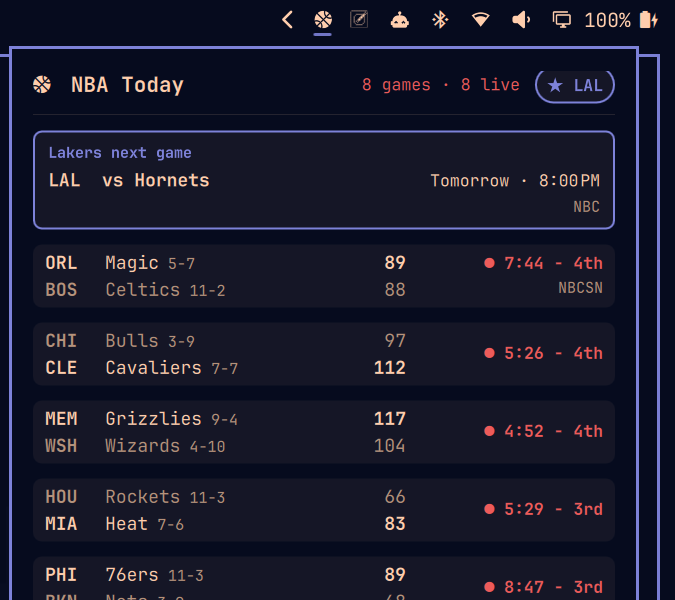
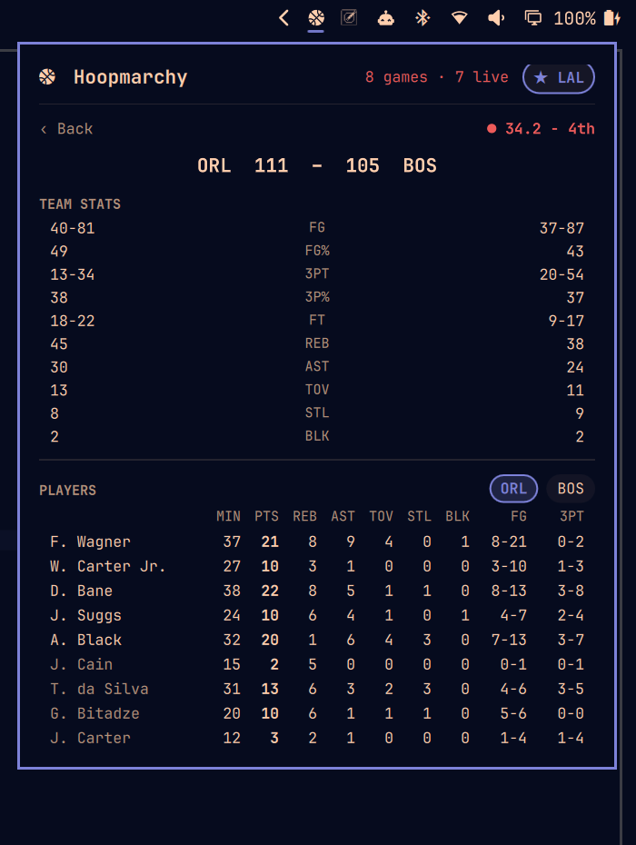

# 🏀 Hoopmarchy

An [Omarchy](https://omarchy.org) bar plugin that shows today's NBA games, with live scores, box scores and reminders for your team.

<p>
  
  
</p>

## Features

- **Today's scoreboard.** A basketball icon in the bar opens every game of the day, with the score, game clock or start time, and each team's record. Live games are listed first.
- **National broadcasts only.** Each game lists where it's on nationally, such as ESPN, NBC, Peacock, Prime Video or NBA TV. Regional networks and team apps are left out.
- **Your home team.** Pick a team from the ☆ button in the panel. Its game is pinned to the top. On days it doesn't play, a card shows its next game.
- **Game reminders.** With a home team picked, you get a desktop notification at 10:00 AM on game day and another one hour before tip-off.
- **Box scores.** Click any game to see team stats side by side, and a box score for each team: MIN, PTS, REB, AST, TOV, STL, BLK, FG and 3PT. Live games refresh every 30 seconds.

## Install

```bash
omarchy plugin add https://github.com/jonathanda1/hoopmarchy
```

When asked, enable it and choose the `right` section of the bar. If the icon doesn't appear, restart the shell with `omarchy restart shell`.

## Usage

| Action | What it does |
|---|---|
| Left-click the icon | Open or close the panel |
| Middle-click the icon | Refresh now |
| Click a game | Show team and player stats |
| ☆ Home team | Pick your team (or None) |
| Esc | Go back, then close the panel |

To open the panel from a keybinding, use `omarchy-shell shell toggle jonathanda1.hoopmarchy`.

## Notes

- Scores, schedules and stats come from ESPN's public site API. This plugin isn't affiliated with ESPN or the NBA, and the API can change without notice.
- Reminders come from the Omarchy shell on your computer, so none are sent while it's off. A missed 10 AM reminder is sent when the computer wakes up, as long as there's still more than an hour to tip-off.
- Your team is saved in `~/.local/state/omarchy/hoopmarchy.json`. Reminders already sent are tracked in `~/.local/state/omarchy/hoopmarchy-reminders.json`.
- After updating the plugin, run `omarchy restart shell` so the new version loads.

## Uninstall

```bash
omarchy plugin remove jonathanda1.hoopmarchy
```

## License

MIT
